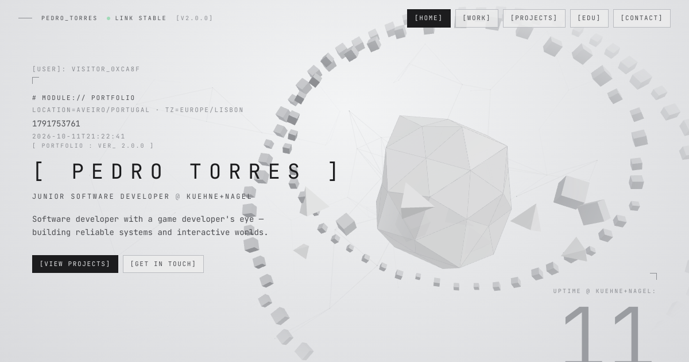

# Pedro Torres — Portfolio

Personal portfolio of **Pedro Torres**, junior software developer at **Kuehne+Nagel** with a background in computer engineering and a Master's in Digital Game Development (University of Aveiro).

🔗 **Live:** https://pedrotorres1001.github.io/PortfolioPedroTorres/



## Design

A light "system interface" aesthetic: monospaced type, bracketed labels, thin lines and archive-style record cards, with a low-poly three.js scene in the hero.

- **Palette** — ice grey `#E4E5E7`, surface `#ECECEC`, ink `#1C1C1E`, single accent `#22C55E`
- **Type** — JetBrains Mono (self-hosted via Fontsource)
- **Motion** — short boot screen, scramble text on hover, custom cursor, scroll reveals. All of it is disabled when the visitor prefers reduced motion.

## Sections

| # | Section | What's in it |
|---|---------|--------------|
| — | Hero | Name, current role, live metadata, "uptime" at Kuehne+Nagel, 3D scene |
| 01 | Work | Kuehne+Nagel record log + working principles |
| 02 | Projects | Numbered index with hover preview and a detail dialog |
| 03 | Education | Bachelor's and Master's at the University of Aveiro |
| 04 | Contact | EmailJS form, LinkedIn, Instagram, email |

## Editing content

**All text lives in [`src/constants/index.js`](src/constants/index.js)** — profile, work, education, projects, socials and the EmailJS keys. Components only read from there, so updating the site never requires touching JSX. The page `<title>` and meta description are injected from the same file at build time.

To add a job, add an object to `work` (the first entry is the featured one). `startDate` uses `YYYY-MM-DD` and drives the tenure and uptime counters.

To add a project, add an object to `myProjects` and drop a `.webp` image in `public/assets/projects/`.

## Stack

React 19 · Vite · Tailwind CSS 4 · three.js + React Three Fiber · Motion · EmailJS

The 3D scene is lazy-loaded after the first paint and pauses when it's off-screen. Reduced-motion visitors get a static SVG fallback.

## Development

```bash
npm install
npm run dev       # http://localhost:5173/PortfolioPedroTorres/
npm run build
npm run deploy    # builds and publishes dist/ to GitHub Pages (gh-pages branch)
```

## Structure

```
src/
├── constants/index.js   # all content
├── components/          # Frame, Scramble, Cursor, Boot, HeroScene, ...
├── sections/            # Navbar, Hero, Work, Projects, Education, Contact, Footer
├── App.jsx
└── index.css            # design tokens
```
